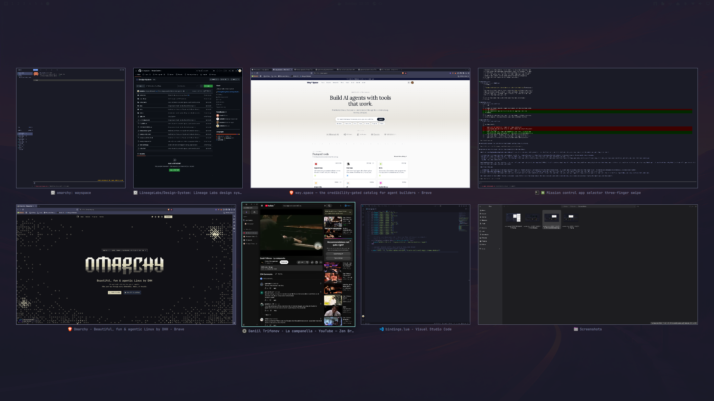

# Birdseye



Birdseye is a Mission Control-style overview for [Omarchy](https://omarchy.org).
Open it and every window you have — on every workspace — is laid out as a grid
of live thumbnails on a dimmed backdrop. Click one, or arrow to it and press
Enter, and Hyprland takes you there.

It's for the moment when you know the window you want but not which
workspace you left it on.

Plugin id: `erasmus.birdseye`

## What it does

- **Every window, one screen.** Windows from all regular workspaces, sorted by
  workspace then position. Scratchpad and minimized windows (special
  workspaces) are left out.
- **Live thumbnails.** Each cell is a real-time capture of the window, not a
  stale snapshot, so you can see a build finish or a page load from the grid.
- **Shape-preserving layout.** Thumbnails keep their window's aspect ratio and
  share one height per row; the layout picks the row count that makes them
  largest for your screen.
- **Keyboard or mouse.** Hover to select, click to jump. Or use the arrows,
  Tab / Shift+Tab, and Enter. Escape or a click on the backdrop closes it.
- **Follows your theme.** Colours, font and corner radius come from the
  Omarchy shell, so it matches whatever theme is active.

## Install

```bash
omarchy plugin add https://github.com/erasmus/omarchy-birdseye.git --enable
```

Then give it a key. Omarchy does not load Hyprland binds from plugins, so add
this to `~/.config/hypr/bindings.lua`:

```lua
o.bind("SUPER + Y", "Birdseye window overview", "omarchy-shell shell toggle erasmus.birdseye")
```

Hyprland reloads on save. `SUPER + Y` is unbound by default; pick another key
if you use it for something else.

### Touchpad gestures (optional)

Three-finger swipe up to open, swipe down to close — add to
`~/.config/hypr/input.lua`:

```lua
hl.gesture({ fingers = 3, direction = "up",   action = function() hl.exec_cmd("omarchy-shell shell summon erasmus.birdseye '{}'") end })
hl.gesture({ fingers = 3, direction = "down", action = function() hl.exec_cmd("omarchy-shell shell hide erasmus.birdseye") end })
```

Omarchy's default three-finger horizontal gesture (switch workspace) keeps
working alongside these.

## Using it

| Action | Keys / mouse |
|---|---|
| Open / close | your bind (`SUPER + Y` above) |
| Select | hover, or ← → ↑ ↓, Tab / Shift+Tab |
| Jump to window | click, or Enter / Space |
| Close without jumping | Escape, or click the backdrop |

Jumping focuses the window and raises it to the top of its stack; if it lives
on another workspace, Hyprland switches there.

## Requirements

- Omarchy with the shell plugin API (manifest schema version 1) and the Lua
  Hyprland config. Tested on Omarchy 4.5, Hyprland 0.56.2 and Quickshell 0.3.2.
- A connected monitor. Birdseye refuses to open while no real output is
  present and closes itself if the set of monitors changes while it's up —
  Hyprland 0.56.2 can crash if a window capture starts during a monitor
  hot-plug.

## Privacy and safety

Birdseye runs inside the Omarchy shell process, like every shell plugin. What
it touches:

- **Hyprland IPC** (via Quickshell) to list windows and to focus the one you
  pick. The focus request is only ever sent for a window address that matches
  `0x[hex]`.
- **Wayland screencopy** of each window, only while the overview is open and
  actually visible. Captures stop the moment it closes; nothing is written to
  disk.

It makes no network requests, spawns no processes, and reads no files beyond
its own translations and the icon theme (for the app icon under each
thumbnail).

Thumbnails show whatever is on screen in those windows, including windows on
other workspaces — the same thing you would see by switching to them.

## Uninstall

```bash
omarchy plugin remove erasmus.birdseye
```

Remove the bind and gesture lines from your Hyprland config too, or the key
will do nothing.

## Development

The whole plugin is three files:

- `Birdseye.qml` — the overlay: window collection, selection, keyboard
  handling, thumbnails.
- `Layout.js` — the justified-row grid layout and row-to-row navigation.
- `i18n/en.json` — strings.

Edits to a plugin under `~/.config/omarchy/plugins/` hot-reload in the running
shell. Validate before committing:

```bash
omarchy plugin validate ~/.config/omarchy/plugins/erasmus.birdseye
```

## License

MIT — see [LICENSE](LICENSE).
